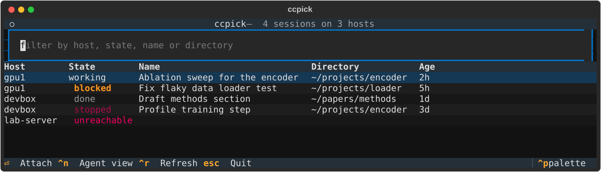

# ccpick

Browse and attach to [Claude Code](https://code.claude.com/docs) background sessions on all your SSH hosts from one terminal list.



Claude Code's agent view (`claude agents`) lists the background sessions on the machine it runs on. ccpick asks each of your SSH hosts for that list, shows them together, and attaches to the one you pick over SSH. Sessions keep running on their host when you detach or your connection drops.

## Requirements

- Python 3.10+ and OpenSSH on your machine
- On each host: Claude Code with agent view (`claude agents --json` works), and an SSH login without a prompt (a key in your agent), since ccpick lists hosts with `BatchMode=yes`

## Install

```sh
uv tool install git+https://github.com/sdraeger/ccpick
# or
pipx install git+https://github.com/sdraeger/ccpick
```

## Usage

```sh
ccpick gpu1 devbox                 # sessions on these hosts
export CCPICK_HOSTS="gpu1 devbox"  # default hosts
ccpick --list gpu1                 # tab-separated: host, id, state, name, cwd
```

| Key | Action |
| :- | :- |
| typing | filter by host, state, name or directory (every word must match) |
| `↑` `↓` | move |
| `Enter` | attach to the session |
| `Ctrl+N` | open agent view on the selected host, for example to start a session |
| `Ctrl+R` | refresh |
| `Esc` | quit |

In an attached session, `Ctrl+Z` returns to ccpick and `←` opens the host's agent view (`Esc` there also returns to ccpick). The session keeps running either way.

## Notes

- Only background sessions appear. A session started with plain `claude` belongs to its terminal and can't be attached. Send it to the background with `/bg`, or run `/config defaultToAgentsView=true` on the host so new sessions start in the background.
- Commands run through the host's login shell (`$SHELL -lic`), so `PATH` and proxy settings from your profile apply.
- If the connection drops while you're attached, ccpick reconnects every 3 seconds (`Ctrl+C` gives up). Add `ServerAliveInterval 10` and `ServerAliveCountMax 3` to the host in `~/.ssh/config` so a dead connection is noticed within about 30 seconds.

## Development

```sh
uv sync
uv run pytest
```

ccpick is not affiliated with Anthropic. MIT license.
